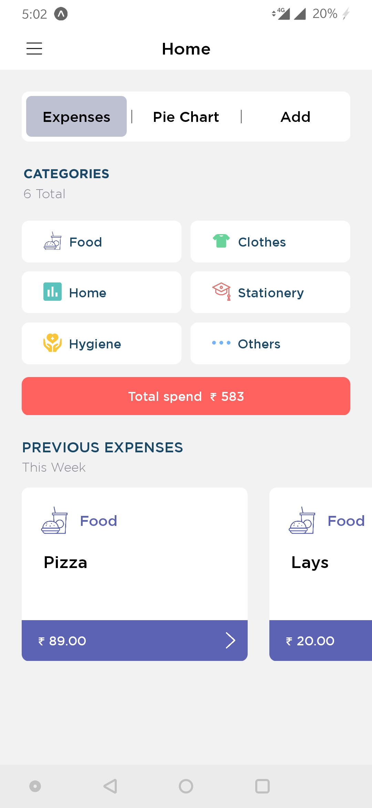
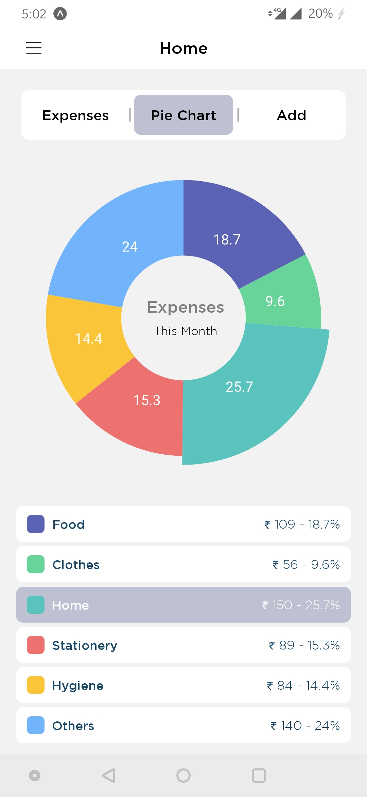
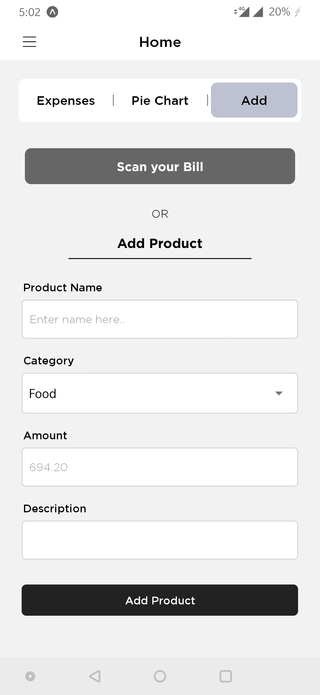
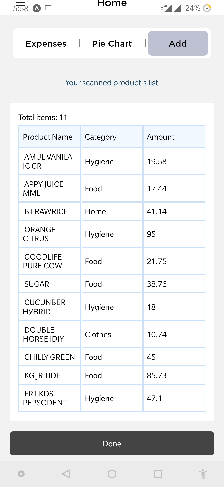
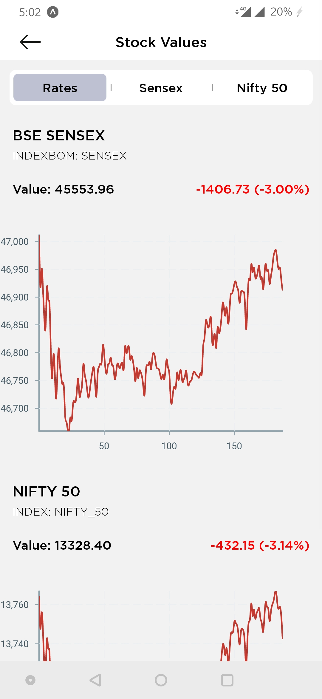
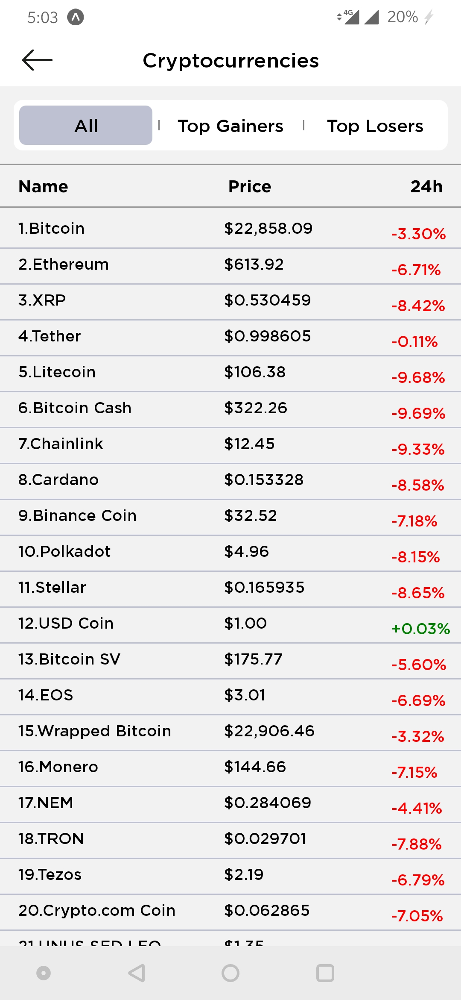

<div align="center">

# Finance Tracker

Track your daily expenses, scan bills instead of typing them, and follow the markets in one app.

     

</div>

<table>
  <tr><th>Expenses</th><th>Pie chart</th><th>Add expense</th></tr>
  <tr><td></td><td></td><td></td></tr>
</table>

## About

Finance Tracker is a personal finance app built as a team project for the InOut 7.0 hackathon. Instead of typing every purchase, you can photograph a bill: the app reads it with OCR, extracts each product and its price, and sorts every item into a spending category with a machine learning model. It also shows where your money goes each month and keeps an eye on the stock and crypto markets.

> The original team repository is [GrayFlash/finance_tracker](https://github.com/GrayFlash/finance_tracker). A React Native CLI rewrite of the app lives at [MyAnalystApp/finance-tracker-native](https://github.com/MyAnalystApp/finance-tracker-native).

## Screenshots

| Scanned bill | Stock market | Cryptocurrencies |
| :---: | :---: | :---: |
|  |  |  |

## Features

- **Expenses**: spending grouped into six categories, this month's total, and editable cards for recent purchases
- **Pie chart**: a category-wise breakdown of this month's spending
- **Scan a bill**: take or pick a photo of a bill; every product and amount is read automatically and categorized
- **Manual entry**: add an expense by name, category and amount
- **Market today**: live Sensex and Nifty 50 values with charts and constituent prices
- **Cryptocurrencies**: prices for all coins, plus top gainers and losers
- **Profile**: monthly income, savings target and this month's status

## How bill scanning works

1. The app uploads the photo to a Flask service.
2. Google Cloud Vision OCR reads the text and its position on the bill.
3. Product names and prices are paired up from the OCR output.
4. A TF-IDF + Multinomial Naive Bayes model, trained on about 64,000 labelled product names, predicts each product's category.
5. The app shows the items in a table so you can review them and save them as expenses.

## Tech Stack

| Area | Technology |
| --- | --- |
| Mobile app | React Native, Expo SDK 39, React Navigation, react-native-chart-kit |
| Backend | Node.js, Express, MongoDB (Mongoose), Cheerio to scrape market data |
| OCR and ML | Python, Flask, Google Cloud Vision, OpenCV, scikit-learn |

## Getting Started

**Prerequisites:** Node.js, the Expo CLI, a MongoDB database, Python 3.8 and a Google Cloud project with the Vision API enabled

### 1. Start the API server

```bash
cd expo/server
npm install
MONGODB_URI="<your MongoDB connection string>" node app.js
```

The server listens on port `3000`.

### 2. Start the OCR and ML service (optional, for bill scanning)

```bash
cd expo/ML
pip install flask numpy pandas pillow opencv-python scikit-learn google-cloud-vision
export GOOGLE_APPLICATION_CREDENTIALS="/path/to/service-account.json"
python app.py
```

### 3. Start the app

Set your API server URL in `expo/screens/HttpLink.js` and your OCR service URL in `expo/components/AddPageComponents/ScanBill.js`, then run:

```bash
cd expo
npm install
npm start
```

Scan the QR code from the Expo CLI with the Expo Go app.

See [Deployment.md](Deployment.md) for deployment notes and [Resources.md](Resources.md) for the articles that helped build the OCR pipeline.

## Project Structure

```
.
├── expo/
│   ├── screens/         # Home, Stock, Crypto and Profile screens
│   ├── components/      # expenses, pie chart, bill scanning and manual entry
│   ├── routes/          # navigation stack
│   ├── server/          # Express + MongoDB API and market data
│   ├── ML/              # Flask OCR service and the category model (NLP/)
│   └── assets/          # images, fonts and README screenshots
└── py_trial/            # early OCR experiments
```
